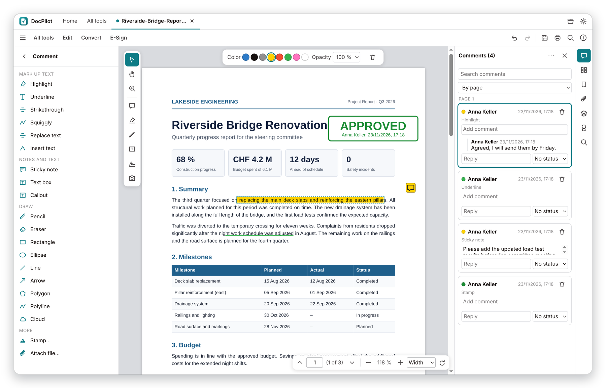
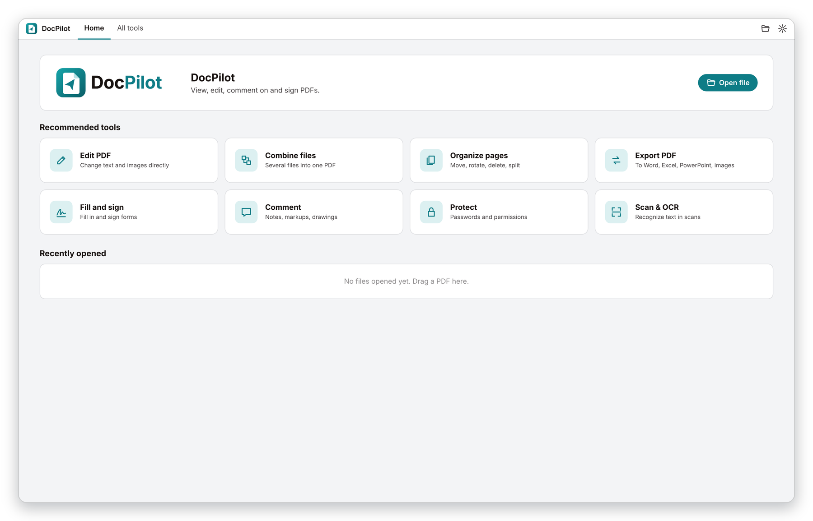
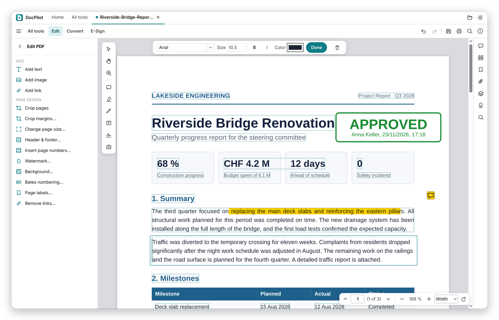
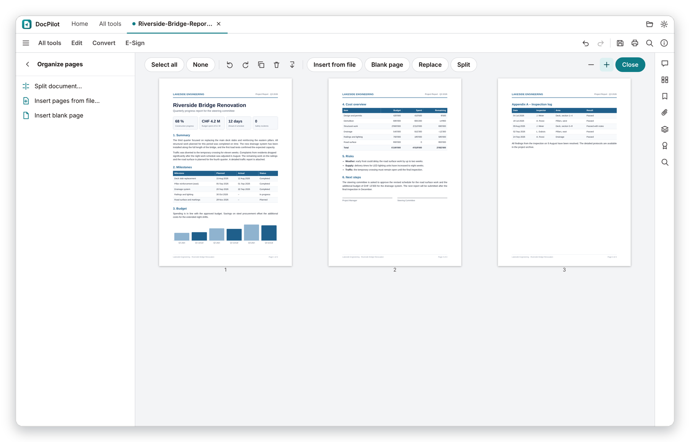
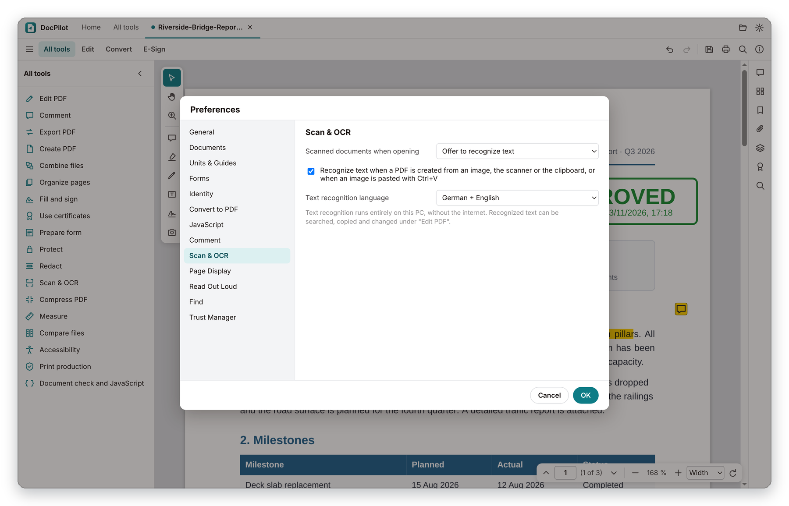

<p align="center">
  
</p>

<h1 align="center">DocPilot</h1>

<p align="center">View, edit, comment on and sign PDFs.<br>A Windows PDF editor with a familiar, easy-to-use layout.</p>

<p align="center">
  
  
  
  
  
</p>

<p align="center">
  
</p>

---

## Overview

DocPilot is a Windows program for working with PDF files. The interface uses a familiar layout: menu bar, tabs, tools pane on the left, quick tools on the side, sidebar on the right and page controls at the bottom right. It is distributed as an MSI installer.

| Area | Selected features |
|---|---|
| View | Zoom, page layouts, rotate, reading mode, full screen, rulers, grid, find, read out loud |
| Comment | Highlight, sticky notes, text boxes, shapes, drawing, stamps, replies, XFDF |
| Edit | Change, move and add text directly, move and resize images, header & footer, watermark, Bates |
| Fonts | All fonts like in Word (including Office cloud fonts such as Aptos), default font from Word |
| Pages | Move, rotate, delete, insert, extract, split, combine |
| Forms | Fill in, create fields, export/import data, JavaScript only after approval by IT |
| Fill and sign | Fill in and sign, digital ID, sign digitally and validate |
| Protect | Password (AES-256), permissions, redact, sanitize |
| Convert | Export to Word, Excel, PowerPoint, image, HTML, text. PDF from images, Office files, scanner |
| Scans | Offline text recognition (DE, EN, FR, IT), automatic detection of scanned documents, edit recognized text in the image, paste screenshots with Ctrl+V |
| More | Compress, compare, measure, PDF/A |

The complete list, including all known limitations, is in **[FEATURES.md](FEATURES.md)**.

## Screenshots

<table>
  <tr>
    <td width="50%" valign="top">
      
      <p align="center"><b>Home</b><br><sub>Recommended tools and recently opened files at a glance.</sub></p>
    </td>
    <td width="50%" valign="top">
      
      <p align="center"><b>Edit PDF</b><br><sub>Change text directly on the page, in the original layout.</sub></p>
    </td>
  </tr>
  <tr>
    <td width="50%" valign="top">
      
      <p align="center"><b>Organize pages</b><br><sub>Reorder, rotate, insert, replace and split pages.</sub></p>
    </td>
    <td width="50%" valign="top">
      
      <p align="center"><b>Preferences</b><br><sub>Clearly structured, with offline text recognition.</sub></p>
    </td>
  </tr>
</table>

<p align="center"><sub>The document shown is a fictional sample report.</sub></p>

## Technology

| Component | Purpose | License |
|---|---|---|
| [Electron](https://www.electronjs.org/) | Windows program | MIT |
| [PDF.js](https://mozilla.github.io/pdf.js/) | Rendering, text layer, forms, script sandbox | Apache 2.0 |
| [pdf-lib](https://github.com/cantoo-scribe/pdf-lib) (Cantoo fork) | Writing PDFs, encryption | MIT |
| [Tesseract.js](https://tesseract.projectnaptha.com/) | Text recognition (OCR) | Apache 2.0 |
| [node-forge](https://github.com/digitalbazaar/forge) | Digital signatures (PKCS#7) | BSD/GPL (BSD chosen) |
| docx, ExcelJS, PptxGenJS, mammoth | Office export and import | MIT / BSD |
| electron-builder (WiX) | MSI installer | MIT |

Components with an AGPL license were deliberately avoided. The full list of included open-source components and their license texts is in [THIRD_PARTY_NOTICES.md](THIRD_PARTY_NOTICES.md).

### Structure

```
electron/        Main process: window, menu, file access, printing, Office conversion
  fonts.js       Font catalog like Word, default font from Normal.dotm
src/             User interface
  main.js        App: tabs, home page, commands
  viewer.js      Page rendering
  overlay.js     Comment tools
  editor.js      Edit PDF (text and images)
  fonts.js       Fonts for input and preview
  fontpicker.js  Font picker like Word
  scan.js        Text recognition, scan detection, editing recognized text in images
  tools.js       All tool groups
  panels.js      Sidebars
  prefs.js       Preferences (Ctrl+K)
  pdf/           PDF core: page operations, content stream, comments, signatures,
                 removing text from images (inpaint.js), analysis of
                 recognized text: bullets, punctuation, paragraphs (ocrlayout.js)
scripts/         Build, icons (npm run icons) and third-party notices (npm run notices)
tests/           Automated tests (app and PDF core)
assets/          Logo and icons
docs/            Screenshots for this README
```

## Development

Requirements: Windows 10/11 and [Node.js](https://nodejs.org/) (developed and tested with version 26).

```bash
npm ci
```

| Command | Effect |
|---|---|
| `npm start` | Build and start the app |
| `npm run build` | Build only the user interface to `dist/renderer` |
| `npm run test:core` | PDF core tests (21 tests, about 1 minute) |
| `npm test` | App tests in the real Electron app (46 flows, about 18 minutes) |
| `npm run dist` | Build the MSI installer to `release/` |
| `npm run icons` | Create the app icons from `assets/emblem.svg` |
| `npm run notices` | Regenerate `THIRD_PARTY_NOTICES.md` after dependency updates |
| `npm run lint` | Check the code |

Individual app tests can be run with a name filter, for example `node tests/run.js "Text over text"`.

The app tests run against the development build. With `DP_TEST_POLICY=allow`, JavaScript and macros are allowed for the tests; without the variable, the IT block applies. The variable only works in the development build, never in the installed program. Because of the security fuses, the built program can no longer be remote-controlled with Playwright.

## Deployment

```bash
msiexec /i DocPilot-1.0.1-x64.msi /qn
```

- Installs for all users of the PC and requires administrator rights.
- Start menu and desktop shortcuts; PDF is registered as a file type.
- A new MSI replaces the installed version automatically. Increase the version in `package.json` for every new release.
- **Open:** The MSI is not yet digitally signed. Without a code signing certificate, Windows SmartScreen warns and AppLocker may block it.

## Security

- **JavaScript in PDFs and macros in Office files are permanently blocked.** Users cannot turn them on, not even through the settings file. Only IT can enable them through the policy `HKLM\SOFTWARE\Policies\DocPilot` (details in [FEATURES.md](FEATURES.md#it-policy-javascript-and-macros)).
- File attachments are never run, only saved. On its own, the program only opens folders, never files or programs.
- Links only open web pages and email, after confirmation.
- HTML is converted without JavaScript and without internet access.
- Electron fuses: the `.exe` cannot be misused as a Node.js interpreter, through `NODE_OPTIONS` or with a debugger, and it only loads its own verified app archive.

---

## License

Copyright © 2026 Iroxle. All rights reserved. The source code is published for viewing and reference only; see [LICENSE](LICENSE).
Third-party components are licensed under their own terms; see [THIRD_PARTY_NOTICES.md](THIRD_PARTY_NOTICES.md).

All trademarks are the property of their respective owners.
