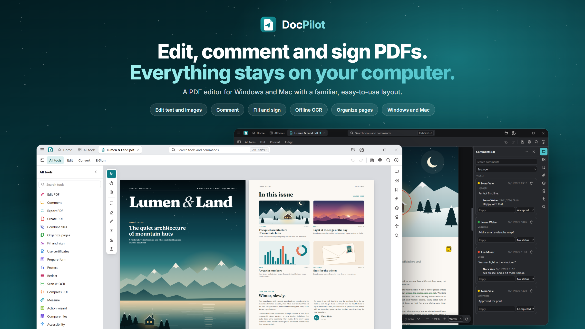
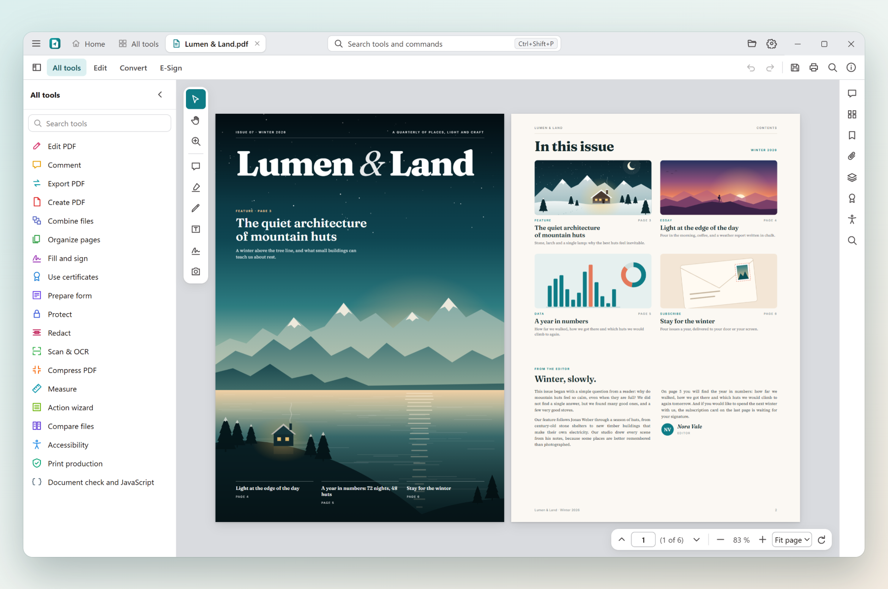
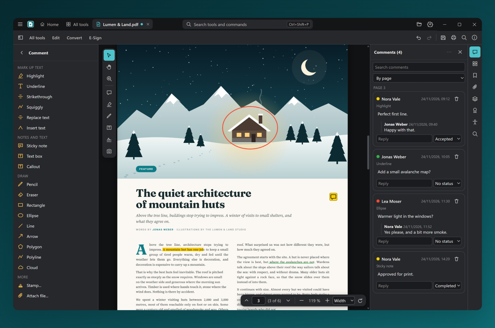
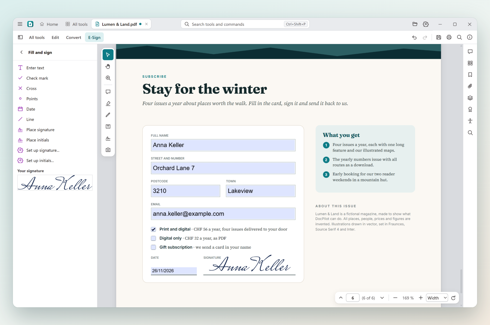

<p align="center">
  
</p>

<p align="center">
  <a href="https://github.com/Iroxle/docpilot/releases/latest"></a>
  
  
  
  <a href="https://github.com/Iroxle/docpilot/releases"></a>
</p>

<table width="100%">
  <tr>
    <td width="50%" valign="top" align="center">
      <br>
      <a href="https://github.com/Iroxle/docpilot/releases/latest">
        
      </a>
      <h3>Download DocPilot</h3>
      <p>Get the latest release for Windows and Mac:<br>setup, MSI or portable for Windows, disk image for Mac.</p>
      <strong><a href="https://github.com/Iroxle/docpilot/releases/latest">Download latest version →</a></strong>
      <br><br>
    </td>
    <td width="50%" valign="top" align="center">
      <br>
      <a href="FEATURES.md">
        
      </a>
      <h3>Features and limitations</h3>
      <p>Everything DocPilot can do, tool by tool,<br>and an honest list of what it cannot do yet.</p>
      <strong><a href="FEATURES.md">View all features →</a></strong>
      <br><br>
    </td>
  </tr>
</table>

<details>
<summary><strong>Who is this for?</strong></summary>

DocPilot is for people and teams on Windows and Mac who work with PDFs every day and want one program for it: reading, commenting, editing text and images, filling in and signing forms, redacting, converting to and from Office, and making scans searchable and editable. Everything runs on your own computer. Documents are never uploaded, and text recognition works offline.

For IT departments there is an MSI for silent, machine-wide installation. JavaScript in PDFs and macros in Office files are blocked, so documents cannot run code on your PC.
</details>

<details>
<summary><strong>Recent changes</strong></summary>

- **2026-11-27 (1.2.0):** New look: tabs in the title bar with the menu and a search field for all tools and commands.
- **2026-11-27 (1.2.0):** New home page: recent files as pictures of their first page; colored tools with a search in the tools pane.
- **2026-11-27 (1.2.0):** Edit PDF: the text field shows bold and regular parts and columns exactly as they are set; edited text no longer disappears.
- **2026-11-27 (1.2.0):** Check boxes and radio buttons in PDF forms show whether they are checked again.
- **2026-11-27 (1.2.0):** Accessibility: automatic tagging, Tags panel, alternate text and a full check with fixes.
- **2026-11-27 (1.2.0):** OCR in several files, scan clean-up, straightened phone photos, review of recognized words.
- **2026-11-27 (1.2.0):** Action wizard for several files; XFA forms become normal pages and form fields.
- **2026-11-27 (1.2.0):** Change or remove header, footer, watermark and background; print several pages per sheet and booklets.
- **2026-11-27 (1.2.0):** Print production: grayscale, hairlines, printer marks, page boxes; export all images and Markdown.
- **2026-11-27 (1.2.0):** Measure tools snap to lines and points; search commands; reopen closed tab; recovery after a crash.

<details>
<summary><strong>Older</strong></summary>

- **2026-11-26 (1.1.0):** DocPilot for Mac: disk images for Apple silicon and Intel Macs, with the same features as on Windows.
- **2026-11-26 (1.1.0):** Forms format and calculate without JavaScript; field properties, date and image fields, XFDF/FDF/XML/CSV data.
- **2026-11-26 (1.1.0):** Saving appends the changes: signed documents can be filled in and signed again; certify; PDF/A check and conversion.
- **2026-11-26 (1.1.0):** Real redaction: only what lies under the marks is removed, the rest of the page stays sharp text.
- **2026-11-26 (1.1.0):** Reduce file size: images to the resolution the pages show them at, black-and-white scans as Group 4.
- **2026-11-26 (1.1.0):** Combine, insert, extract and split keep bookmarks, links, form fields, layers and attachments.
- **2026-11-26 (1.1.0):** Edit PDF: moved text keeps its exact font and size, and tables on invoices stay one block.
- **2026-11-26 (1.1.0):** Security: updated built-in browser engine (Electron 45.5.0).
- **2026-11-24 (1.0.2):** Find and replace in the whole document, including recognized text in scans.
- **2026-11-24 (1.0.2):** Form fields are detected automatically, with a preview before they are created.
- **2026-11-24 (1.0.2):** Tables arrive as real tables in Word, Excel and PowerPoint exports.
- **2026-11-24 (1.0.2):** Skewed scans are straightened for text recognition; new "Straighten page" command.
- **2026-11-24 (1.0.2):** Dark appearance: Light, Dark or Same as Windows.
- **2026-11-23 (1.0.1):** First public release. Clean recognition and editing of scans with tables, logos and image strips.

</details>

The full list is in [CHANGELOG.md](CHANGELOG.md).
</details>

<details>
<summary><strong>Table of contents</strong></summary>

- [Overview](#overview)
- [Screenshots](#screenshots)
- [What to download](#what-to-download)
- [Technology](#technology)
- [Development](#development)
- [Releases](#releases)
- [Deployment in organizations](#deployment-in-organizations)
- [Security](#security)
- [Contributing](#contributing)
- [License](#license)

</details>

---

## Overview

DocPilot is a program for Windows and macOS for working with PDF files. The interface uses a familiar layout: tabs in the title bar with the menu and a search field for all tools and commands, tools pane on the left, quick tools on the side, sidebar on the right and page controls at the bottom right. For Windows it is available as a setup program, as an MSI for IT deployment and as a portable version; for Mac as a disk image for Apple silicon and Intel.

| Area | Selected features |
|---|---|
| View | Zoom, page layouts, rotate, reading mode, full screen, rulers, grid, find, read out loud |
| Find and replace | Replace text in the whole document, including recognized text in scans; "Replace all" as a single undo step |
| Comment | Highlight, sticky notes, text boxes, shapes, drawing, stamps, replies, XFDF |
| Edit | Change, move and add text directly, move and resize images, header & footer, watermark, Bates |
| Fonts | All fonts like in Word (including Office cloud fonts such as Aptos), default font from Word |
| Pages | Move, rotate, delete, insert, extract, split, combine |
| Forms | Fill in, create fields or have them detected automatically, export/import data; JavaScript in forms is blocked |
| Fill and sign | Fill in and sign, digital ID, sign digitally and validate |
| Protect | Password (AES-256), permissions, redact, sanitize |
| Convert | Export to Word, Excel, PowerPoint (tables as real tables, numbers and dates as values), image, HTML, text. PDF from images, Office files, scanner |
| Scans | Offline text recognition (DE, EN, FR, IT), automatic detection of scanned documents, read and straighten skewed scans, edit recognized text in the image, paste screenshots with Ctrl+V |
| More | Compress, compare, measure, PDF/A, light or dark appearance |

The complete list, including all known limitations, is in **[FEATURES.md](FEATURES.md)**. What is new in each version is listed in **[CHANGELOG.md](CHANGELOG.md)**.

## Screenshots

<table>
  <tr>
    <td width="50%" valign="top">
      
      <p align="center"><b>Read</b><br><sub>One or two pages side by side, thumbnails, bookmarks and full screen.</sub></p>
    </td>
    <td width="50%" valign="top">
      
      <p align="center"><b>Comment</b><br><sub>Highlights, notes and shapes, with replies and status. Light, dark or the same as the system.</sub></p>
    </td>
  </tr>
  <tr>
    <td width="50%" valign="top">
      
      <p align="center"><b>Edit PDF</b><br><sub>Change text directly on the page, in the original layout.</sub></p>
    </td>
    <td width="50%" valign="top">
      
      <p align="center"><b>Fill and sign</b><br><sub>Form fields are detected automatically, then filled in and signed.</sub></p>
    </td>
  </tr>
  <tr>
    <td width="50%" valign="top">
      
      <p align="center"><b>Home</b><br><sub>Drop or open a PDF; recent files appear as pictures of their first page.</sub></p>
    </td>
    <td width="50%" valign="top">
      
      <p align="center"><b>Organize pages</b><br><sub>Reorder, rotate, insert, replace and split pages.</sub></p>
    </td>
  </tr>
</table>

<p align="center"><sub>The document shown is <b>Lumen &amp; Land</b>, a fictional sample magazine. <a href="docs/sample/Lumen-and-Land.pdf">Download the sample PDF</a> and try DocPilot with it.</sub></p>

## What to download

| OS | Architecture | Format | Best for | Download link |
|---|---|---|---|---|
| **Windows 10 / 11** | x64 | `.exe` (setup) | Most people. Installs for your user, no administrator rights needed. | [DocPilot setup for Windows](https://github.com/Iroxle/docpilot/releases/latest/download/DocPilot-Setup-x64.exe) |
| **Windows 10 / 11** | x64 | `.msi` | IT departments. Installs for all users, supports silent installation. | [DocPilot MSI for Windows](https://github.com/Iroxle/docpilot/releases/latest/download/DocPilot-x64.msi) |
| **Windows 10 / 11** | x64 | `.exe` (portable) | Trying it out or a USB stick. Runs without installation. | [DocPilot portable for Windows](https://github.com/Iroxle/docpilot/releases/latest/download/DocPilot-Portable-x64.exe) |
| **macOS 12 or later** | Apple silicon | `.dmg` | Macs with an M-series chip (from late 2020). | [DocPilot for Mac (Apple silicon)](https://github.com/Iroxle/docpilot/releases/latest/download/DocPilot-mac-arm64.dmg) |
| **macOS 12 or later** | Intel | `.dmg` | Older Macs with an Intel processor. | [DocPilot for Mac (Intel)](https://github.com/Iroxle/docpilot/releases/latest/download/DocPilot-mac-x64.dmg) |

All versions and their checksums (`SHA256SUMS.txt`) are on the [releases page](https://github.com/Iroxle/docpilot/releases).

- **Windows warning:** The installers are not digitally signed yet. Windows SmartScreen may show "Windows protected your PC". Choose "More info" and then "Run anyway".
- **Portable version:** It does not register PDF as a file type and starts a little slower, because it unpacks itself on every start.
- **Mac: which file?** Apple menu > About This Mac shows "Chip" (Apple silicon) or "Processor" (Intel).
- **Mac: first start.** Open the disk image and drag DocPilot into the Applications folder. DocPilot for Mac is not notarized by Apple yet, so macOS asks once before the first start: open DocPilot, close the message, then go to System Settings > Privacy & Security and click "Open Anyway" next to DocPilot. On macOS 14 and earlier, Control-click DocPilot in the Applications folder and choose "Open" instead.
- **Mac differences:** Keyboard shortcuts use ⌘ instead of Ctrl. Office files are converted with Microsoft Office for Mac if it is installed. Details are in [FEATURES.md](FEATURES.md#mac).
- **Linux:** DocPilot is not available for Linux.

## Technology

| Component | Purpose | License |
|---|---|---|
| [Electron](https://www.electronjs.org/) | Desktop program for Windows and macOS | MIT |
| [PDF.js](https://mozilla.github.io/pdf.js/) | Rendering, text layer, forms, script sandbox | Apache 2.0 |
| [pdf-lib](https://github.com/cantoo-scribe/pdf-lib) (Cantoo fork) | Writing PDFs, encryption | MIT |
| [Tesseract.js](https://tesseract.projectnaptha.com/) | Text recognition (OCR) | Apache 2.0 |
| [node-forge](https://github.com/digitalbazaar/forge) | Digital signatures (PKCS#7) | BSD/GPL (BSD chosen) |
| docx, ExcelJS, PptxGenJS, mammoth | Office export and import | MIT / BSD |
| electron-builder (NSIS, WiX, DMG) | Setup, MSI, portable and Mac builds | MIT |

Components with an AGPL license were deliberately avoided. The full list of included open-source components and their license texts is in [THIRD_PARTY_NOTICES.md](THIRD_PARTY_NOTICES.md).

### Structure

```
electron/        Main process: window, menu, file access, printing, Office conversion
  fonts.js       Font catalog like Word, default font from Normal.dotm
  mac.js         macOS: Office conversion, scanner, font folders
src/             User interface
  main.js        App: tabs, home page, commands
  viewer.js      Page rendering
  overlay.js     Comment tools
  editor.js      Edit PDF (text and images)
  find.js        Find and replace
  formauto.js    Detect form fields automatically: preview and creation
  fonts.js       Fonts for input and preview
  fontpicker.js  Font picker like Word
  scan.js        Text recognition, scan detection, editing recognized text in images
  tools.js       All tool groups
  panels.js      Sidebars
  prefs.js       Preferences (Ctrl+K), including the appearance (light, dark, same as the system)
  styles.css     Look; all interface colors as variables (dark: only different values)
  pdf/           PDF core: page operations, content stream, comments, signatures,
                 removing text from images (inpaint.js), analysis of
                 recognized text: bullets, punctuation, paragraphs (ocrlayout.js),
                 replacing within a paragraph including rewrap (replace.js), detecting
                 form positions from lines, boxes and circles (formdetect.js), detecting
                 tables for export (tables.js), rotation angle of skewed scans (deskew.js)
scripts/         Build, icons (npm run icons), third-party notices (npm run notices), release notes,
                 Mac scanner helper (mac/scan.swift)
tests/           Automated tests (app and PDF core)
assets/          Logo and icons
docs/            Screenshots and images for this README
.github/         Release workflow and pull request template
```

## Development

Requirements: Windows 10/11 or macOS 12 or later, and [Node.js](https://nodejs.org/) (developed and tested with version 26).

```bash
npm ci
```

| Command | Effect |
|---|---|
| `npm start` | Build and start the app |
| `npm run build` | Build only the user interface to `dist/renderer` |
| `npm run test:core` | PDF core tests (25 tests, about 1 minute) |
| `npm test` | App tests in the real Electron app (50 flows, about 23 minutes) |
| `npm run dist` | Build the setup, MSI and portable version to `release/` |
| `npm run dist:msi` | Build only the MSI |
| `npm run dist:mac` | Build the Mac disk images to `release/` (only on a Mac with the Xcode command line tools) |
| `npm run icons` | Create the app icons from `assets/emblem.svg` |
| `npm run notices` | Regenerate `THIRD_PARTY_NOTICES.md` after dependency updates |
| `npm run lint` | Check the code |

Individual app tests can be run with a name filter, for example `node tests/run.js "Text over text"`.

The app tests run against the development build. With `DP_TEST_POLICY=allow`, JavaScript and macros are allowed for the tests; without the variable, both stay blocked. The variable only works in the development build, never in the installed program. Because of the security fuses, the built program can no longer be remote-controlled with Playwright.

## Releases

Installers are built by GitHub Actions ([release.yml](.github/workflows/release.yml)) on a Windows and a Mac runner:

1. Set the new version in `package.json` and add a section for it to [CHANGELOG.md](CHANGELOG.md).
2. Push to `main`.

If there is no release for that version yet, the workflow runs the tests on Windows and macOS, builds the setup, the MSI, the portable version and the two Mac disk images, and publishes them as release `v<version>` with checksums. The release text is the changelog section of that version. A release is only published when the Windows tests pass (one step whose text recognition differs slightly on the GitHub machines is skipped there); on macOS, failed tests are reported as warnings, because the app tests were written for Windows. Pushes to `main` that do not change the version do nothing. Pushes to other branches and pull requests run the tests and build everything without publishing. Running the workflow by hand ("Run workflow") does the same, optionally publishing a release.

The Mac app is signed ad hoc. Once the repository has an Apple Developer ID certificate and an Apple ID as secrets (see the comment at the top of the workflow), it is signed and notarized by Apple, and the first-start step on the Mac is no longer needed.

## Deployment in organizations

```bash
msiexec /i DocPilot-x64.msi /qn
```

- The MSI installs for all users of the PC and requires administrator rights.
- Start menu and desktop shortcuts; PDF is registered as a file type.
- A new MSI replaces the installed version automatically.
- The setup (`.exe`) installs per user instead. Use one of the two on a PC, not both.
- **Mac:** DocPilot can be distributed like any other app from a disk image, for example with device management (MDM).
- **Open:** The installers are not yet digitally signed. Without a code signing certificate, Windows SmartScreen warns and AppLocker may block them.

## Security

- **JavaScript in PDFs and macros in Office files are blocked.** Documents cannot run scripts, and Office files are converted without running their macros.
- File attachments are never run, only saved. On its own, the program only opens folders, never files or programs.
- Links only open web pages and email, after confirmation.
- HTML is converted without JavaScript and without internet access.
- Electron fuses: the program cannot be misused as a Node.js interpreter, through `NODE_OPTIONS` or with a debugger, and it only loads its own verified app archive.

## Contributing

Bug reports and suggestions are welcome as [issues](https://github.com/Iroxle/docpilot/issues/new/choose): there is a form for bug reports (with the DocPilot version and your system) and one for ideas. Please never attach confidential documents. For pull requests there is a [template](.github/pull_request_template.md) that asks what was changed, how it was tested and under which terms the contribution is made. Please run `npm run lint` and `npm run test:core` before opening one.

---

## License

Copyright © 2026 Iroxle. All rights reserved. The official installers from the releases page may be installed and used; the source code is published for viewing and reference. See [LICENSE](LICENSE) for the exact terms.
Third-party components are licensed under their own terms; see [THIRD_PARTY_NOTICES.md](THIRD_PARTY_NOTICES.md).

All trademarks are the property of their respective owners.
